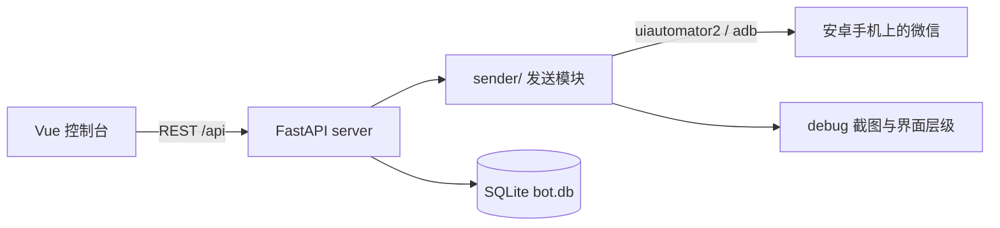

# wechat-bot

电脑通过 `uiautomator2` 驱动安卓手机上的微信，把文本发到指定会话，并提供一个本地 Web 控制台。

> **当前状态：第一期只实现「发送消息」链路。** 群内指令识别、「活跃日榜」统计、定时发榜都还没有实现，见文末「路线」。

## 能做什么 / 不能做什么

- **能**：向指定会话发送中文、多行、emoji 文本；演练模式（只填文本、不点发送）；发送结果写入 SQLite；FastAPI 接口 + Vue 控制台用于配置、预览和查看日志。
- **不能**：不读取聊天记录、不做统计、不监听群消息、不绕过微信客户端、不提供账号或协议服务。
- **不需要**：第一期**不需要 PC 版微信**，只要一台已登录微信的安卓手机和 USB 调试权限。

## 架构



所有业务逻辑都在电脑上，手机只是被控终端，不需要在手机上安装额外应用。`uiautomator2` 3.x 会在运行时通过 adb 拉起设备端服务，因此**不需要**执行旧版的 `python -m uiautomator2 init`。

### 扩展发送通道

`sender/` 是一个可插拔的包：

| 文件 | 职责 |
| --- | --- |
| `base.py` | `Sender` 协议与 `SendError` |
| `config.py` | 配置加载、adb 环境注入、模板自动生成 |
| `text.py` | 文本规范化与校验探针（纯函数，不依赖设备） |
| `store.py` | SQLite 发送日志 |
| `u2.py` | 当前唯一实现 `U2Sender`，通过 uiautomator2 驱动手机 |
| `__init__.py` | 统一导出与 `create_sender()` 工厂 |

新增通道（例如 PC Hook、常驻无障碍 App）时：写一个实现 `send(target, text) -> bool` 的类，在 `create_sender()` 里注册一个分支，再把 `config.json` 的 `sender_channel` 改成对应名字即可。`server` 和 CLI 都通过工厂拿发送器，不需要改动。

## 环境要求

| 组件 | 要求 |
| --- | --- |
| Python | 3.10 及以上（开发验证用 3.13） |
| Node.js | 20.19+ 或 22.12+（Vite 8 的要求，验证用 22） |
| 安卓手机 | 开启开发者选项与 USB 调试，微信已登录，保持解锁与屏幕常亮 |
| adb | Android SDK `platform-tools`，需在 PATH 中或写入配置 |
| 操作系统 | Windows 实测，其他平台可使用相同的 uv 启动命令 |

## 快速开始

```bash
git clone https://github.com/YaoZeyuan/wechat-bot.git
cd wechat-bot

uv sync

cd web
pnpm install --frozen-lockfile
cd ..
```

首次运行会自动从 `config.example.json` 生成一份本机私有的 `config.json`（默认是「文件传输助手 + 演练模式」，不会真的发消息）：

```bash
uv run python check_env.py
```

它会打印 Python / adb / 设备 / 微信安装状态，以及手机端准备清单。手机准备好后：

1. 编辑 `config.json`：填 `adb_dir`（platform-tools 目录）、`serial`（多设备时指定）、`default_target`（目标会话名）。
2. 先演练，确认文本正确填入了目标会话的输入框：

   ```bash
   uv run dev-sender --text "发送链路测试" --dry-run
   ```

3. 确认无误后再实际发送：

   ```bash
   uv run dev-sender --text "发送链路测试" --to "某群名"
   ```

启动 Web 控制台（两个终端）：

```bash
# 终端 1：API 服务，监听 127.0.0.1:8000
uv run dev-server

# 终端 2：前端，默认 http://127.0.0.1:3000
uv run dev-web
```

前端通过 Vite 代理把 `/api` 转发到 8000。Windows 上 `5101–5200` 可能被系统保留为动态端口（Hyper-V / WSL），所以前端默认用 3000；如被占用改 `web/vite.config.ts` 的 `port`。

## 配置说明

`config.json` 是本机私有文件，**不要提交**。所有可配置项：

| 字段 | 说明 |
| --- | --- |
| `adb_dir` | platform-tools 目录；留空则依赖系统 PATH 中的 adb |
| `sender_channel` | 发送通道名，默认 `u2`；新增实现后在这里切换 |
| `serial` | 设备序列号，留空自动选择；WiFi 连接填 `IP:端口` |
| `default_target` | 默认会话名，模板为「文件传输助手」 |
| `dry_run` | `true` 时只填文本不点发送，模板默认 `true` |
| `step_delay` / `page_load_delay` | 点击间隔 / 页面切换等待（秒）；微信响应慢就调大 |
| `wait_timeout` / `verify_timeout` | 控件等待 / 发送后校验超时（秒） |
| `max_chars` | 单条文本长度上限，默认 1800，超出直接拒绝 |
| `result_class` | 会话名控件的类名 |
| `selectors` | 各步骤的控件候选，按顺序匹配；微信改版只改这里 |
| `debug_dir` / `database` | 调试快照目录 / SQLite 文件 |

文本在发送前会被规范化：CRLF 转 LF、移除 NUL 等控制字符，保留换行、制表符、emoji 与零宽字符；纯空白或空文本会被拒绝。

## 使用方式

### 命令行

```bash
uv run dev-sender --text "内容"                 # 发到默认目标
uv run dev-sender --to "某群名" --text "内容"   # 指定会话
uv run dev-sender --text "内容" --dry-run        # 只演练
uv run dev-sender --file rank.txt               # 从 UTF-8 文件读多行文本
uv run dev-sender --devices                     # 列出 adb 设备
uv run dev-sender --dump                        # 导出当前界面层级，用于调选择器
```

`--dry-run` 和失败时会在 `debug/` 保存截图与界面层级 XML，方便排查。

### HTTP API

| 方法 | 路径 | 用途 |
| --- | --- | --- |
| GET | `/api/health` | Python / u2 / FastAPI 版本与数据库状态 |
| GET | `/api/devices` | adb 设备列表与连接状态 |
| GET / PATCH | `/api/config` | 读取 / 修改本机配置 |
| POST | `/api/send/preview` | 预览规范化后的文本、长度与告警 |
| POST | `/api/send` | 执行发送（支持 `dry_run`） |
| GET | `/api/logs` | 最近发送日志 |
| GET | `/api/stats` | 今日发送次数统计 |

接口文档在 server 启动后的 `/docs`。

### 微信版本与选择器

微信更新后 `resource-id` 常变，控件定位全部放在 `config.json` 的 `selectors` 里，代码不硬编码。找不到控件时：

1. 手机停在出问题的界面，运行 `send.py --dump`；
2. 打开 `debug/hierarchy.xml`，找到目标节点的 `text`、`resource-id` 或 `class`；
3. 把新的候选追加到对应选择器数组的最前面。

已验证过的输入方式：`selector.set_text()` 能可靠写入中文与多行文本；`d.send_keys()` 在部分设备上会静默失败，因此代码对每次写入都做结果校验，失败时依次回退到 `send_keys` 与剪贴板粘贴，三者都失败会明确报错而不是误报成功。

## 隐私与忽略规则

以下文件包含本机环境或聊天数据，**已在 `.gitignore` 中排除，请勿提交**：

| 路径 | 原因 |
| --- | --- |
| `config.json` | 本机 adb 路径、设备序列号、真实会话名 |
| `debug/` | 手机界面截图与层级，可能含聊天内容、昵称、头像 |
| `*.db`、`*.db-*` | 发送日志，含目标会话与消息正文 |
| `.venv/`、`web/node_modules/`、`web/dist/` | 依赖与构建产物 |
| `.workbuddy/`、`__pycache__/`、`*.log`、`.env*` | 本地工作记录、缓存与可能的凭据 |

仓库里只保留 `config.example.json` 模板，不含任何真实设备、账号或会话信息。

## 风险与免责

- 自动化操作个人微信号可能违反微信软件许可及服务协议，存在被限制登录、功能受限或移出群聊的风险。
- 建议低频、单群、使用非主力账号；本项目不提供绕过限制、批量群发或多账号管理能力。
- 本项目仅供个人学习与自用，与微信官方无任何关联；使用者需自行承担账号与数据风险。

## 路线

- **已完成**：消息发送链路、演练模式、发送校验、SQLite 日志、FastAPI 接口、Vue 控制台、配置与选择器外置。
- **待实现**：聊天记录采集与落库、群内指令识别（如「活跃日榜」）、当日发言数 Top10 统计、触发/定时发榜、群白名单与防刷、榜单文本模板。

## 许可证

MIT，详见 [LICENSE](LICENSE)。

## 根目录开发命令

安装 uv 和Node.js 和 pnpm 后，分别在终端运行：

```sh
uv run dev-server
uv run dev-web
uv run dev-sender --help
```

前两个命令分别启动 API（8000）和 Web（3000）。发送器是按次执行的 CLI，例如 `uv run dev-sender --devices`。读取本地数据库无需开启 Mock。
