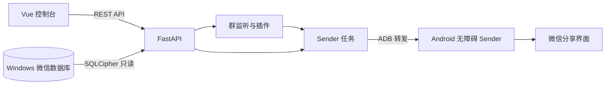

# wechat-bot

面向个人用户的本地微信机器人。Windows 端使用 SQLCipher 只读访问已配置的微信数据库，Android 端通过 USB 执行发送，Web 控制台管理初始化、群监听、插件和发送任务。

- 在 Web 分页查看联系人、群聊和聊天记录。
- 按群 ID 监听，最多同时启用 10 个群。首次开启从当前进度开始。
- 每群配置「测试」和「活跃日榜」。测试关键词按整条文本精确匹配。日榜按北京时间统计当天发言数。
- 文字任务优先在目标会话内发送。会话定位失败时使用微信分享确认收件人。PNG、JPEG、TXT 和 PDF 通过微信分享发送。混合任务先发附件，再发文字。Web 显示逐步日志和手机画面。

## 架构



`sender_channel: "accessibility"` 用于 Web 任务和插件发送。项目也提供 `u2` 通道，可通过 uiautomator2 执行文字调试。群配置存放于 `local-data/group-plugins.json`，发送任务和步骤保存在本地 SQLite。

## 环境要求

| 组件 | 要求 |
| --- | --- |
| Python | 3.10 及以上（开发验证用 3.13） |
| Node.js | 20.19+ 或 22.12+（Vite 8 的要求，验证用 22） |
| 安卓手机 | 开启开发者选项与 USB 调试，微信已登录，保持解锁与屏幕常亮 |
| adb | Android SDK `platform-tools`，需在 PATH 中或写入配置 |
| 操作系统 | Windows 实测，其他平台可使用相同的 uv 启动命令 |

## 快速开始

```bash
git clone https://github.com/YaoZeyuan/wechat-bot.git
cd wechat-bot

uv sync

cd web
pnpm install --frozen-lockfile
cd ..
```

首次运行会自动从 `config.example.json` 生成一份本机私有的 `config.json`（默认是「文件传输助手 + 演练模式」，不会真的发消息）：

```bash
uv run python check_env.py
```

环境检查会列出 Python、ADB、手机和微信的状态。按下文「手机无障碍 Sender」安装并启用手机服务，将本机 `config.json` 的 `sender_channel` 设为 `accessibility`。

启动 Web 控制台（两个终端）：

```bash
# 终端 1：API 服务，监听 127.0.0.1:8000
uv run dev-server

# 终端 2：前端，默认 http://127.0.0.1:3000
uv run dev-web
```

前端通过 Vite 代理把 `/api` 转发到 8000。Windows 上 `5101–5200` 可能被系统保留为动态端口（Hyper-V / WSL），所以前端默认用 3000；如被占用改 `web/vite.config.ts` 的 `port`。

## 配置说明

`config.json` 是本机私有文件，**不要提交**。所有可配置项：

| 字段 | 说明 |
| --- | --- |
| `adb_dir` | platform-tools 目录；留空则依赖系统 PATH 中的 adb |
| `sender_channel` | 模板默认 `u2`，Web 系统分享和插件实发使用 `accessibility` |
| `serial` | 设备序列号，留空自动选择；WiFi 连接填 `IP:端口` |
| `default_target` | 默认会话名，模板为「文件传输助手」 |
| `dry_run` | `true` 时只填文本不点发送，模板默认 `true` |
| `step_delay` / `page_load_delay` | 点击间隔 / 页面切换等待（秒）；微信响应慢就调大 |
| `wait_timeout` / `verify_timeout` | 控件等待 / 发送后校验超时（秒） |
| `max_chars` | 单条文本长度上限，默认 1800，超出直接拒绝 |
| `result_class` | 会话名控件的类名 |
| `selectors` | 各步骤的控件候选，按顺序匹配；微信改版只改这里 |
| `debug_dir` / `database` | 调试快照目录 / SQLite 文件 |

文本在发送前会被规范化：CRLF 转 LF、移除 NUL 等控制字符，保留换行、制表符、emoji 与零宽字符；纯空白或空文本会被拒绝。

## 使用方式

### 命令行

```bash
uv run dev-sender --text "内容"                 # 发到默认目标
uv run dev-sender --to "某群名" --text "内容"   # 指定会话
uv run dev-sender --text "内容" --dry-run        # 只演练
uv run dev-sender --file rank.txt               # 从 UTF-8 文件读多行文本
uv run dev-sender --devices                     # 列出 adb 设备
uv run dev-sender --dump                        # 导出当前界面层级，用于调选择器
```

`--dry-run` 和失败时会在 `debug/` 保存截图与界面层级 XML，方便排查。

### HTTP API

| 方法 | 路径 | 用途 |
| --- | --- | --- |
| GET | `/api/health` | Python / u2 / FastAPI 版本与数据库状态 |
| GET | `/api/devices` | adb 设备列表与连接状态 |
| GET / PATCH | `/api/config` | 读取 / 修改本机配置 |
| POST | `/api/send/preview` | 预览规范化后的文本、长度与告警 |
| POST | `/api/send` | 执行发送（支持 `dry_run`） |
| GET | `/api/logs` | 最近发送日志 |
| GET | `/api/stats` | 今日发送次数统计 |
| POST | `/api/sender/jobs` | 提交 Web 和插件共用的版本化发送任务 |
| GET | `/api/sender/jobs/{request_id}` | 查询任务结果和中文步骤日志 |

接口文档在 server 启动后的 `/docs`。

### 微信版本与选择器

以下步骤用于 `u2` 通道，其控件候选配置在 `config.json` 的 `selectors`。

1. 手机停在出问题的界面，运行 `uv run dev-sender --dump`；
2. 打开 `debug/hierarchy.xml`，找到目标节点的 `text`、`resource-id` 或 `class`；
3. 把新的候选追加到对应选择器数组的最前面。

已验证过的输入方式：`selector.set_text()` 能可靠写入中文与多行文本；`d.send_keys()` 在部分设备上会静默失败，因此代码对每次写入都做结果校验，失败时依次回退到 `send_keys` 与剪贴板粘贴，三者都失败会明确报错而不是误报成功。

## 隐私与忽略规则

以下文件包含本机环境或聊天数据，**已在 `.gitignore` 中排除，请勿提交**：

| 路径 | 原因 |
| --- | --- |
| `config.json` | 本机 adb 路径、设备序列号、真实会话名 |
| `debug/` | 手机界面截图与层级，可能含聊天内容、昵称、头像 |
| `*.db`、`*.db-*` | 发送日志，含目标会话与消息正文 |
| `.venv/`、`web/node_modules/`、`web/dist/` | 依赖与构建产物 |
| `.workbuddy/`、`__pycache__/`、`*.log`、`.env*` | 本地工作记录、缓存与可能的凭据 |

仓库里只保留 `config.example.json` 模板，不含任何真实设备、账号或会话信息。

## 风险与免责

- 自动化操作个人微信号可能违反微信软件许可及服务协议，存在被限制登录、功能受限或移出群聊的风险。
- 建议低频、单群、使用非主力账号；本项目不提供绕过限制、批量群发或多账号管理能力。
- 本项目仅供个人学习与自用，与微信官方无任何关联；使用者需自行承担账号与数据风险。

## 后续计划

继续验收真实群插件回复和附件加文字的混合发送。网页分享、引用原消息和 @ 群成员的实现计划见 [项目计划](plan/项目计划.md)。

## 许可证

MIT，详见 [LICENSE](LICENSE)。

## 根目录开发命令

安装 uv 和Node.js 和 pnpm 后，分别在终端运行：

```sh
uv run dev-server
uv run dev-web
uv run dev-sender --help
```

前两个命令分别启动 API（8000）和 Web（3000）。发送器是按次执行的 CLI，例如 `uv run dev-sender --devices`。读取本地数据库无需开启 Mock。

「Sender」标签（`/sender`）显示是否有且仅有一台已授权的手机。让手机微信停在首页，填写完整的联系人或群聊名称和文本。默认显示「实际发送」，需要验证定位时手动勾选「仅演练」，由后端调度 sender。

`uv run dev-server` 默认监控 `server/` 和 `sender/` 中的 Python 文件并自动重启 API。需要关闭热重载时使用 `uv run dev-server --no-reload`。

`dev-server` 在终端和 `local-data/logs/server.log` 同时输出 JSON 日志。常见日志的 `msg` 为中文，`event` 保留原始事件。日志单个文件约 5 MiB，最多保留 3 个历史文件。请求日志包含路由、状态码、耗时和请求 ID，可用响应头 `X-Request-ID` 定位对应请求。规则和手机任务按投递 ID 关联。

在「聊天记录」打开群聊，点击「启用机器人」，该群会出现在「规则与任务」的监听群列表。列表最多同时启用 10 个群。全局轮询间隔（1–100 秒，默认 5 秒）在列表页设置。点击群列表的「配置」或直接打开 `/group?group=<群 ID>`，可切换插件、配置关键词并查看该群的执行记录。群 ID 用于匹配，界面优先显示备注。暂停群监听会保留规则和游标。

插件参考 MaiBot 的稳定标识、注册表和配置分离方式。所有群共用一份插件目录，规则引用插件 ID，开关按群保存。「测试」默认启用，可在群配置页修改精确关键词和回复。「活跃日榜」默认关闭，启用后收到同名指令会回复北京时间当天的前十名。两个内置插件的群配置保存在 `local-data/group-plugins.json`。命中时由 Server 按插件顺序提交 Sender 文字任务。HTTP 回调及其他插件默认关闭。聊天页的会话和消息按页读取，接口单页最多返回 100 条。

「插件管理」展示插件版本、能力和默认状态。「打开百度」启用时会添加关键词「测试」规则（保留同名已有规则）；开启全局监听后，收到该关键词将在运行后端的电脑打开默认浏览器。「测试消息」可在群配置页手动触发，先用手机打开对应群聊并清空输入框，再确认发送「测试成功」。

在「微信初始化」页选择账号目录，选择结果会写入 `local-data/account-selection.json`，下次打开自动回填。填入数据库密钥后点击「验证并保存配置」，将目录、账号 ID、数据库密钥及可选的图片 XOR/AES 密钥写入 `local-data/reader-profile.json`。图片密钥可手动填入。整个 `local-data/` 已由 Git 忽略。后台监听优先使用验证过的配置，切换账号前先停止监听。

已有一致的离线数据库副本及对应密钥时，可导出一个群的文本消息。命令需要明确指定副本路径，未保存该账号密钥时会交互询问。

Windows 手动取钥需要在后端启用 `WECHAT_BOT_KEY_EXTRACTION=1`，并提供 `local-data/tools/wechat_key_tool.dll`（也可通过 `WECHAT_BOT_SCANNER_DLL` 指定）。登录完成后点击数据库取钥按钮；图片取钥要先打开朋友圈并查看几张图片。两种操作都由用户点击触发，保持微信进程运行。

```sh
uv run python -m server.export_history --snapshot local-data/snapshot --account wxid_example --group "群名" --output local-data/history.jsonl
```

## 参考项目与致谢

感谢这些项目公开源码和设计，让本项目有了可以对照的实现。

- [CipherTalk（密语）](https://github.com/ILoveBingLu/CipherTalk) 与 [CipherTalk-Backup](https://github.com/Nixer-2301/CipherTalk-Backup)（[本项目使用的 fork](https://github.com/YaoZeyuan/CipherTalk-Backup)）。参考了账号初始化、数据库和图片密钥流程，以及聊天记录展示。
- [FlowBot](https://github.com/xlrpa/FlowBot)。参考了安卓执行端与电脑端任务调度的分工。
- [AstrBot](https://github.com/AstrBotDevs/AstrBot)。参考了消息事件、关键词指令和插件处理函数的分层。
- [MaiBot（麦麦）](https://github.com/Mai-with-u/MaiBot)。参考了 WebUI 将运行状态、配置和执行记录分区的方式。
- [Arco Design Vue](https://github.com/arco-design/arco-design-vue)。用于后台导航及界面组件。
- [android-rpa](https://github.com/1parado/android-rpa)。参考了手机微信搜索控件候选和过滤搜索框、定位会话结果的方式。

## 手机无障碍 Sender

在 `android-sender` 目录用 Android Studio 或 Gradle 8.2 构建
`assembleDebug`，安装 APK 后，在手机系统的无障碍设置中启用
「WeChat Sender」。将项目根目录的本机 `config.json` 中的
`sender_channel` 改成 `accessibility`。先结束旧的 uiautomator2
会话，再将所需的微信实例切到前台。从 Web 的 Sender 页先做一次文字演练，
步骤日志会显示手机服务读到的微信可见节点数。

手机服务经 ADB 转发接收命令，使用 Android 无障碍控件定位和校验。
支持文字、图片和文件的演练与发送。双开选择框出现时，按 Web 日志提示在手机上选择微信实例。群聊发送前会核对群 ID 和唯一显示名。

参考项目 [wechat-rpa-demo](https://github.com/AbbottKilig/wechat-rpa-demo)。

### 部分手机上的微信无障碍兼容性

在单微信测试机上，系统设置可读但微信只返回空根节点。同时启用系统 TalkBack 后，Sender 读到微信首页的 189 个可见节点，并向文件传输助手实发了一条文字测试。该测试机于 2026-11-11 开启并保留 TalkBack。若同一台手机复现此现象，可在系统无障碍设置中启用 TalkBack，再打开微信。TalkBack 会改变触摸手势，停用后微信节点可能再次缺失。
