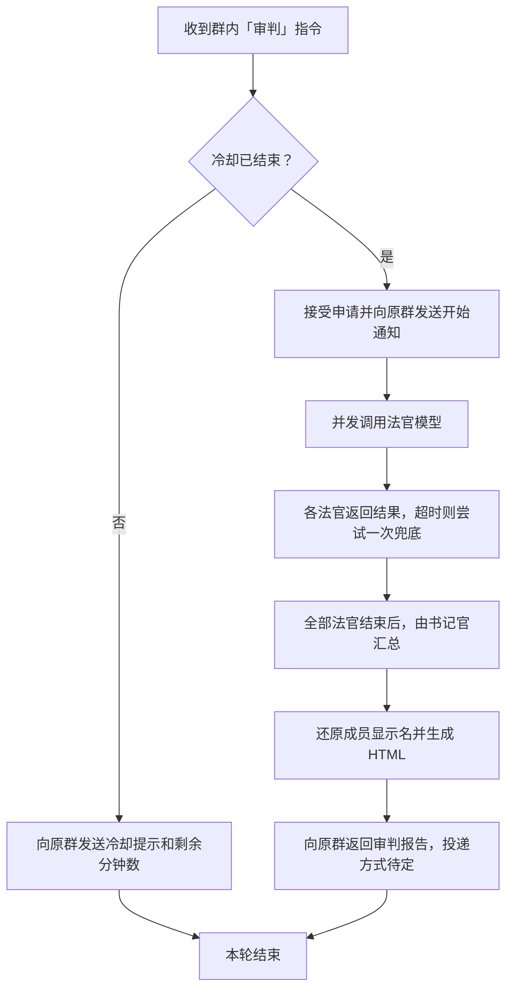

希望增加一个审判功能。逻辑如下

1.  提取群聊发言{{group_chat_history_content}}
2.  为方便后续给出警告列表，所以需要将{{group_chat_history_content}}中的发言人替换为{{@user_id}}形式，对应的，发言中@的人，也要换成@{{@user_id}}，以便ai识别时能准确对应到发言人
3.  允许配置1-3个llm模型作为法官，使用相同输入，进行审判
    1.  配置引导词{{pre_judge_prompt}}，默认为下边的文本，允许每个群中单独配置
        ```txt
        请引用群规，联系上下文，逐句严格判定下列发言是否违规，并区分严重程度，警告违规严重的发言者----注意遵守【不二判】原则，以及豁免对马督工/马前卒个人的相关评论。以下是发言内容：
        ```
    2.  一开始要配置审判规则{{judge_prompt}}，默认为下边的文本，允许每个群中单独配置

        ```txt
        【群规执行】
        任意群友可在任意时间，发送「审判」关键字，由三款AI对原始发言进行裁决，若均判违规，视为终审裁定。若审判结果不一，以对【被裁定者】最有利的AI为准

        机器人不可用时，可以任一网页版AI代替

        群管只可根据AI判定，在确认违规后发出警告并执行，不执行需给出理由

        群内警告默认持续24小时，如无再犯，过期归零，警告经明确告知后最多可延长至7天。近30天内在群人员，累计警告Top3用户，新增警告默认7天。违规时需@被判定人并明确计数，达到3次后移出群聊

        【基础共识】

        1️⃣评论须基于客观事实
        2️⃣以主流AI作为中立参照, 符合社会主义核心价值观

        3️⃣遵守讨论秩序
        - 谁主张，谁举证。不逃避举证责任。举证材料应与所主张观点直接相关，并能合理支撑论点
        - 就事论事，不基于立场评判
        - 接受AI工具校准，但可保留意见

        【基本纲领】
        本群为`睡前消息`讨论群，期望能通过讨论分享资料，提供增量信息，了解现实运行逻辑，以在长时间尺度上改善决策质量，优化现状。

        群聊是公共空间。发言应尽量具有信息、观点、讨论或适度社交价值。

        期望以结果论，群内最终聊天内容值得每日通读

        【不二判】
        若用户已被警告，或判决已撤销，豁免其被警告前的全部违规发言

        【挑衅全责】
        若违反群规导致他人违规，全责归于挑衅方

        【避免troll】
        转发需保障信息的真实有效。若被他人证明为虚假内容，警告1次。连续三次仅转发视为troll，警告1次

        【邀请连坐】
        - 若被邀请人入群前7天内违背群规，计数累加到邀请人的违规次数中(为便拉新，管理员不被连坐)

        【维护氛围】
        - 日发言配额为150条，超出后首次警告告知，随后每次发言均增加警告1次，满3次移出(0点后可重进)
        - 群管日发言配额200条，超出后同群友，管理类发言不限
        - 若发言使讨论氛围劣化，视为违规，需要警告。特征包括不限于：巧言诡辩/纠缠措辞不回应观点/被要求举证后转移话题修改定义等
        - 群主可移除特定用户作为兜底, 但需在知识库中明确公示, 避免滥用

        【不避AI】
        允许非文字发言，但若被AI识别为违规则加重处罚，警告次数x2，归群时限x2

        【以身作则】
        管理员不能豁免自身违规记录，但可由其他管理豁免

        【玩梗从宽】
        作为键政群，对于玩笑要适当容忍，但不接受对弱势群体的伤害

        【尊重常识】
        常识指自然科学以主流科学共识为准、社会事实以公开数据及权威信源为准、逻辑需有合理因果。禁止在拒绝举证的情况下两次以上主张明显违背常识。判断需结合上下文，提供信源或逻辑推演则豁免。

        【厦门新城际群聊规则】
        1. 不煽动情绪，不助长戾气，不搞阴谋论，不强拉对立面，不以个案评判全局，不杜撰事实，不造谣传谣，不捕风捉影，不互相猜疑，不道德绑架，不侮辱他人，不人身攻击，不质疑他人的动机和人品。
        2. 提倡言论自由、互相尊重、就事论事，沟通过程中保持诚恳礼貌冷静，尊重不同邻居的文化差异，不使用`高级黑`/`反讽`/`嘲讽表情`等可能引发误解的语言方式，避免将沟通演变为`怼人`。
        3. 不得暴露他人隐私，不得透露他人未在本群自愿公开的信息、即使他人已在别处自愿公开（包括但不限于姓名、年龄、电话、籍贯、工作、婚姻、家庭等等）
        ```

    3.  以这个格式拼接
        ```txt
        【群规】
        {{pre_judge_prompt}}
        {{judge_prompt}}
        【原始发言】
        {{group_chat_history_content}}
        ```
    4.  llm均来自同一个模型服务商，所以参数都一样，api_base这些放在插件整体配置中，所有群都一样。
        1.  只有api_key、model_name 模型名需要改
    5.  模型输出的文本为审判结果，以下用 {{judge_result_1}}/{{judge_result_2}}/{{judge_result_3}}

4.  需要配置一个llm 作为书记官，输入审判结果，按{{judge_sunmary_prompt}}配置的规则进行汇总
    1.  judge_sunmary_prompt的默认值如下，允许每个群中单独配置
    ```txt
    请对各ai的裁决结果进行汇总，若均判违规，视为终审裁定。
    若审判结果不一，采取对【被裁定者】最有利的ai判定结果，若未明确标记违规则，视为未违规。
    使用 Markdown 表格对结果进行对比呈现。
    如最终存在违规人员，需给出管理员的判定建议。
    ```
5.  由程序将判定词、审判结果拼接为一个html，发送到群里. 拼接格式示例

    ```txt
    审判原始内容(默认折叠)
    [markdown格式的审判词，右上角提供复制按钮]

    (按实际法官数输出，这里假设是3个，所以输出3遍)
    裁决结果-耗时{{该模型审判耗时，舍去小数部分}}秒
    模型-{{模型名}}
    {{模型输出内容}}(默认折叠)
    裁决结果-耗时{{该模型审判耗时，舍去小数部分}}秒
    模型-{{模型名}}
    {{模型输出内容}}(默认折叠)
    裁决结果-耗时{{该模型审判耗时，舍去小数部分}}秒
    模型-{{模型名}}
    {{模型输出内容}}(默认折叠)

    终审汇总-耗时{{该模型审判耗时，舍去小数部分}}秒
    模型-{{模型名}}

    {{书记官模型输出内容}}
    ```

6.  支持以下配置
    1.  审判范围
        1.  审判时间范围(小时): 默认为1，取值范围 1~24, 整数。限定只查询这个时间范围内的聊天记录
        2.  审判条数上限(条): 默认300，取值范围 1~5000, 整数。限定只查询这个条数内的聊天记录
        3.  1/2两条规则均生效，以条数最少的场景为最终确认的聊天内容范围
    2.  审判冷却时间
        1.  默认为分钟，默认为3，取值范围1~60, 整数。
        2.  若发起审判时，距离上一个审判的时间间隔小于冷却时间，则不发起新审判，返回提示「距离上轮xxx 发起的审判间隔不足x分钟，请等待y分钟后再进行」，y为进位制，1秒/59秒均显示为1分钟

## 阶段范围与最新约定

本节补充并明确上文的流程。首阶段仅在 Web 后台验证本地 HTML 效果，页面应适配 PC 和手机。群内监听触发、启动通知、报告投递和自动警告属于后续阶段，交互及投递方式待定。

### 正式群内流程

1. 检测到群成员发送「审判」后，先检查冷却。通过时接受申请，并先向原群发送普通文本「开始执行@xxx 发起的审判」，其中 xxx 为本轮发起人。冷却未结束时，向原群发送「距离上轮xxx 发起的审判间隔不足x分钟，请等待y分钟后再进行」，其中 xxx 为上轮发起人，y 为剩余分钟数向上取整。本轮到此结束。
2. 并发调用配置的 1 至 3 位法官，所有法官使用同一份输入和同一套成员占位 ID。
3. 模型调用超时为 5 分钟。主模型超时后，使用项目全局兜底模型尝试一次。由兜底模型生成的结果标注「[降级]」。最终失败时停止尝试，在对应法官结果中记录「[审判失败]」以及可用的失败原因。
4. 等所有法官任务结束后，把结果交给书记官汇总。各模型使用相同的占位 ID，书记官据此对齐同一成员的裁决。
5. 渲染报告时，把成员占位 ID 替换为实际显示名，优先取群昵称，缺失时取用户名。

### 正式流程图



### 不二判

由模型根据输入内容与群规识别成员此前受到的警告及对应事项。程序不计算豁免时间边界，也不建立警告与被判发言的关联。首阶段报告仅展示模型裁决、汇总和处理建议。

### 本地预览验收

- PC 和手机均可打开 HTML，长裁决正文、对比表格及折叠区均可阅读。
- 原始审判内容和各法官裁决默认折叠，书记官汇总默认展开。原始内容提供复制按钮。
- 页面可区分正常裁决、降级结果和失败原因，并以实际显示名展示占位成员。

### 处罚建议预览

法官返回可读判词，主书记官返回 Markdown 汇总。在群配置启用「自动警告（仅生成建议）」后，复用书记官的模型配置发起独立的处罚提取请求。处罚书记官只提取所有法官均认定违规的发言，返回成员代号、发言编号、原因和按法官顺序排列的原文摘录。程序校验发言归属和摘录，并按成员合并同轮违规。HTML 展示原始发言和原因，结构化结果保存在同名 JSON。当前阶段只生成建议，提取失败时仍生成报告并标出错误。

第三位法官模型默认使用 qwen3.8-27b。
